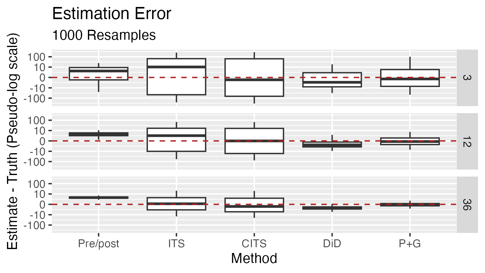
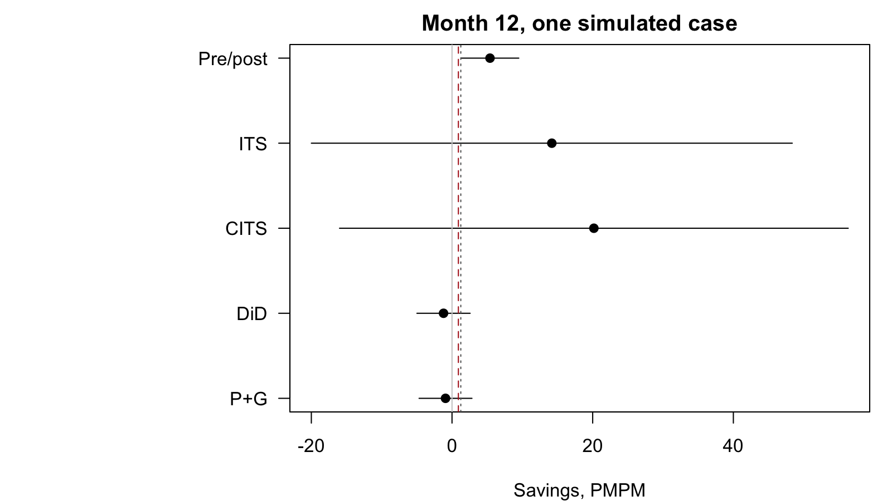

# impact2026

**Worked examples for evaluating a care management savings claim, on simulated data where the true answer is known.**

This repository supports the SOA ImpACT 2026 session *From Vendor Pitch to Credible Savings*. It simulates a care management program in a self-funded (ASO) block. Five estimators then try to recover the program's savings, and each one is scored against the truth across 1,000 Monte Carlo replications:

| Method | Function | Comparison it relies on |
|---|---|---|
| Pre/post | `est_prepost()` | Engaged members against their own prior year |
| Interrupted time series (ITS) | `est_its()` | Buying block's PMPM against its own pre-launch trend |
| Comparative ITS (CITS) | `est_cits()` | Buying block minus non-buying block, against the pre-launch trend of that gap |
| Difference-in-differences (DiD) | `est_did()` | Engaged members against eligible members in groups that did not buy |
| Propensity matching + G-computation (P+G) | `est_matched()` | Engaged members against matched eligible, not-yet-engaged members in any group |

Real claims data can't tell you whether an evaluation method gets the right answer. A simulation can, because the counterfactual is known for every member-month. This repo is a reference for anyone deciding which methods to trust, and why.

All data here is synthetic. No real member, claim, or client data is included or was used.

## The short version



Error (estimate − truth, $ PMPM) at months 12 and 36, from `data-raw/output/operating_characteristics.csv`. The true savings are about **$0.83 PMPM** at month 12 and **$0.63 PMPM** at month 36.

| Method | Bias, mo 12 | SD, mo 12 | 95% CI coverage, mo 12 | Bias, mo 36 | SD, mo 36 | 95% CI coverage, mo 36 |
|---|---:|---:|---:|---:|---:|---:|
| Pre/post | +4.33 | 2.17 | 44% | +4.33 | 0.90 | 0% |
| ITS | +3.34 | 20.27 | 86% | +0.43 | 5.61 | 87% |
| CITS | −0.12 | 23.41 | 84% | −0.77 | 6.54 | 87% |
| DiD | −2.09 | 2.27 | 80% | −1.86 | 0.96 | 47% |
| P+G | −0.24 | 2.38 | 92% | −0.17 | 0.72 | 93% |

What these numbers show, **in this simulated world**:

- **Pre/post** overstates savings by about five times the true effect, and adding data doesn't help. Members become eligible because of a transient spike in utilization, so their costs would have fallen anyway (regression to the mean). By month 36 its confidence interval almost never contains the truth.
- **ITS** is diluted and confounded. The program touches a few dozen members in a block of about 17,000, and a concurrent block-wide change at launch (a stand-in for something like a new virtual care benefit) gets attributed to the program.
- **CITS** removes the concurrent change by differencing against the non-buying groups, so it is nearly unbiased. It is very noisy at the block level, though: at month 12 its standard deviation is about 28 times the effect it is trying to measure.
- **DiD** understates savings. Its comparison members did not pass through the capacity queue, which is prioritized by risk score, and engaged members did, so the two groups are not exchangeable.
- **P+G** comes closest. Bias is small, and coverage is near nominal by month 12. It is not perfect. The simulation includes an unobserved trait, *willingness*, that affects both who engages and later utilization. No matching on observed covariates can remove that, and the remaining bias and slight undercoverage come from it. At month 3, with few engaged members, P+G is imprecise. That is shown on purpose, not smoothed away.

These are properties of estimators *under this data-generating process*. A different DGP can reorder the methods. The useful lesson is the mechanism behind each failure, so you can ask whether the same mechanism is present in the claim you are evaluating.

One typical replication (the seed closest to the Monte Carlo means, not the most flattering one), at month 12:



The red dashed line is the true effect for that replication. <!-- TODO: label the grey dotted line at $1.25 PMPM, e.g. "the savings target from the Part 1 crosswalk" --> Plots for months 3 and 36 are in `data-raw/output/`.

## Getting started

Requires R ≥ 4.1. The lockfile was built on R 4.4.3.

```r
# 1. Clone, then open impact2026.Rproj in RStudio (or start R in the repo root).
#    renv bootstraps itself from .Rprofile on first launch.

# 2. Install the pinned package versions
renv::restore()

# 3. Load the package
devtools::load_all()

# 4. One simulated case, every estimator, analysed at month 12
sim <- simulate_case(case_params(), seed = 1)
estimate_case(sim, cutoff = 11L)
```

`cutoff` is a month index, and launch is month 0, so `cutoff = 11L` means "analyse after 12 months of program experience." Estimates are savings in $ PMPM. Positive means savings.

To change the scenario, override any default in `case_params()`, for example a stronger program or more capacity:

```r
sim <- simulate_case(case_params(effect = c(ed = -0.25, adm = -0.10, med = -0.30),
                                 slots_per_month = 20), seed = 1)
```

To reproduce the full Monte Carlo (1,000 replications × 3 analysis months, which takes a while on one core, so lower `reps` to iterate):

```r
source("calibrate_case.R")
```

This writes `monte_carlo.rds`, `operating_characteristics.csv`, and the forest plots to `data-raw/output/`. `monte_carlo.rds` is not committed, so run this before regenerating the boxplot.

**Corporate networks:** `.Rprofile` points package installs at a dated snapshot of Posit Public Package Manager (`p3m.dev`), so readers get binaries rather than source builds. If your network can only reach an internal CRAN mirror, edit the `repos` line in `.Rprofile` before running `renv::restore()`.

## The simulated case

`simulate_case()` builds a block of 140 self-funded employer groups (about 60,000 members). Forty of them, about 17,000 members, buy a care management program. Higher-cost groups are more likely to buy. Each member-month has Poisson counts of ED visits, admissions, medication-related visits, and primary care visits. Utilization comes from:

- persistent **frailty** (lognormal)
- transient **health shocks**, AR(1) on the log rate, which create regression to the mean
- **winter seasonality** in ED use
- a **concurrent block-wide change** at launch, unrelated to the program
- latent **willingness**, which lowers utilization after the trigger and raises the chance of accepting outreach, and which is never shown to the estimators

Members become **eligible** on a trailing-12-month utilization trigger. They are **engaged** subject to community health worker capacity, offered in risk-score order, and accept based partly on willingness. The **program effect** ramps up over three months (15% fewer ED visits, 6.5% fewer admissions, 20% fewer medication-related visits, and one added PCP visit a year).

The simulation keeps each engaged member's counterfactual (untreated) rate, so `true_effect()` returns the actual savings each estimator is aiming at. Estimators only see what an analyst would see. They never read the latent columns (those prefixed with `.`) or the true savings.

The roxygen documentation for each function (`?simulate_case`, `?est_matched`, and so on) explains the design choices. That includes why matching has a 20-member floor and a plausibility check on fitted values.

## Repository layout

```
R/simulate_case.R         case_params(), simulate_case(): the data-generating process
R/estimate_case.R         true_effect(), the five estimators, estimate_case()
calibrate_case.R          Monte Carlo driver: operating characteristics + forest plots
data-raw/output/          committed results (CSV, PNGs); monte_carlo.rds is regenerated locally
tests/testthat/           checks that the simulation lands on the deck's scale
renv.lock, renv/          pinned package versions
```

## Further reading

- Lopez Bernal, Cummins & Gasparrini (2017, corrigendum 2021; 2018): ITS and CITS
- Roth, Sant'Anna, Bilinski & Poe (2023): the current state of difference-in-differences
- Austin (2011): an accessible introduction to propensity score methods
- Greifer & Stuart (2021): choosing the estimand when matching
- Snowden, Rose & Mortimer (2011): G-computation on a simulated dataset, a close analogue to this repo
- Hernán & Robins (2020), *Causal Inference: What If*
- Linden (2013): regression to the mean in program evaluation
- Duncan (2014), *Managing and Evaluating Healthcare Intervention Programs*, 2nd ed.

## Feedback

If you find a bug, disagree with a modelling choice, or think a different DGP would reorder the methods, please open an issue. This repo is meant to make its assumptions easy to check, and that only works if people check them.

## Disclaimer and license

Views and methods here are the author's own and do not represent any employer or client. All data is simulated.

<!-- Optional: "Portions of the code and documentation were drafted with AI assistance (Claude) and reviewed by the author." -->

MIT License. See `LICENSE`.

Session co-presented with Clement Foltz.
